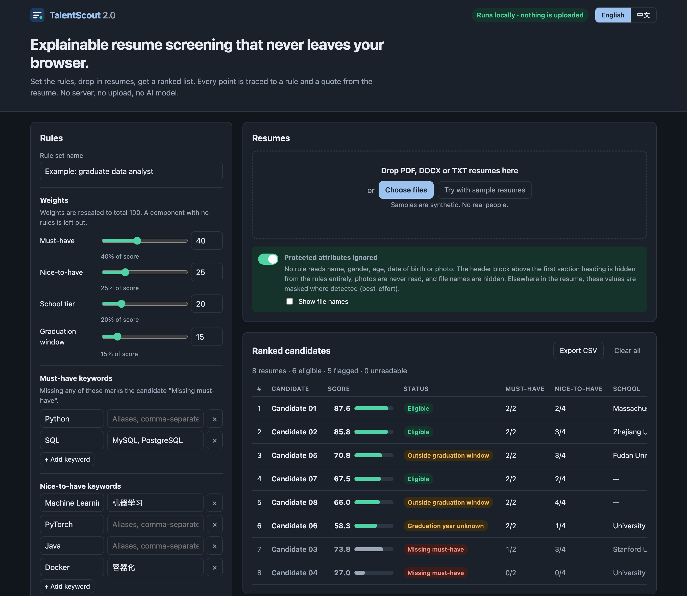
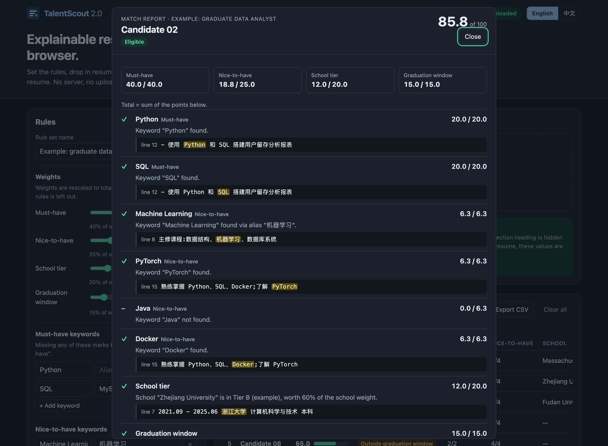
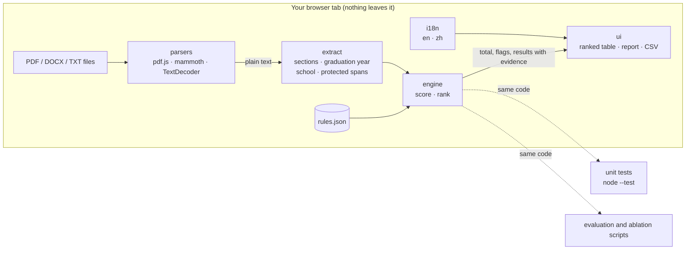

# TalentScout 2.0

**Explainable resume screening that never leaves your browser.**
[中文说明](README.zh-CN.md)

Set the rules, drop in resumes, get a ranked list. Every point of every score
is traced to a rule, a reason and a quote from the resume. There is no server,
no upload and no AI model: the score is arithmetic you can check by hand.



> **Status:** a portfolio project. It is decision support for a human
> reviewer, evaluated on synthetic data only, and has not been tested on real
> applicants. Read [Limitations](#limitations) before using it for anything
> that matters.

## Try it

**Live demo:** <https://1216josh1216-lab.github.io/talentscout/?demo>

**Locally** (needs [Node.js](https://nodejs.org) 22 or newer, no install step for the app itself):

```bash
git clone https://github.com/1216josh1216-lab/talentscout.git
cd talentscout
npm start
```

Then open <http://localhost:8080>. Press **Try with sample resumes**, or drop
in the files from [`samples/`](samples/).

Opening `index.html` by double-clicking it does **not** work: browsers block
JavaScript modules on `file://` pages. The page shows a message telling you
to run `npm start` instead. Any static file server works, for example
`python3 -m http.server`.

## What it does

- **Rules editor.** Must-have and nice-to-have keywords with aliases, school
  tiers, a graduation-year window, and adjustable weights. Rules save and load
  as a JSON file.
- **Bulk upload.** PDF, DOCX and TXT, in English or Chinese, parsed in the
  browser.
- **Ranked list.** Sorted by eligibility, then score. Exports to CSV.
- **Match report per candidate.** Which rule fired, how many points, why, and
  the line of the resume it came from.
- **Protected attributes ignored.** No rule reads name, gender, age, date of
  birth or photo, and the header block of the resume is hidden from the rules
  entirely.
- **English and 中文** interface, reports and CSV.



## How a score is built

A score is 0–100, the sum of four parts. Weights are yours to set and are
rescaled to total 100.

| Part | Rule | Default weight |
|---|---|---|
| Must-have keywords | Share of keywords found. Missing one flags the candidate "Missing must-have" | 40 |
| Nice-to-have keywords | Share of keywords found | 25 |
| School tier | Each tier you define is worth a share of this weight | 20 |
| Graduation window | Full points inside the window. Outside it: zero for this part, or "not eligible", your choice | 15 |

Details that matter:

- **Nothing is dropped silently.** A candidate missing a must-have is flagged
  and ranked below eligible candidates, but stays on the list with a report.
- **Keywords match whole terms.** "Java" does not match "JavaScript"; "SQL"
  does not match "NoSQL". Chinese terms match as substrings.
- **Negation is recognised.** "No experience with Python" and "尚未学习
  Python" earn nothing, and the report says why.
- **Repeating a keyword earns nothing extra.**
- **Graduation year** is read from the education section in many formats:
  `Class of 2025`, `Sep 2021 – Jun 2025`, `09/21 - 06/25`, `2025届`,
  `2025年6月毕业`. A year the tool cannot read is flagged "unknown", not guessed.
- **A file with no readable text** (a scan) is marked "Could not read", not scored zero.

## Privacy, and how to check it

Resume text exists only in the memory of your browser tab. It is not stored
and not sent anywhere. Only your rules and language choice are saved, in the
browser's local storage.

You do not have to take that on trust:

1. Open the browser's developer tools, **Network** tab, and upload a resume.
   Every request goes to the site's own address.
2. View the page source. A Content Security Policy
   (`connect-src 'self'`, `default-src 'none'`) tells the browser to block
   any request to another origin, including from the PDF and DOCX libraries.
3. The two libraries are vendored in [`vendor/`](vendor/), not loaded from a CDN.

## Protected attributes: what is and is not guaranteed

| | |
|---|---|
| **Guaranteed by design** | No rule takes name, gender, age, date of birth or photo as an input. Images in PDF and DOCX files are never read. |
| **Guaranteed by structure** | With the mode on, everything above the first section heading (and any "Personal information" section) is hidden from every rule, whatever it contains. |
| **Best-effort** | Elsewhere in the text, these values are masked when a pattern recognises them. |
| **Not solved** | Graduation year is a proxy for age, and school tier for background. Both are scored if you enable them. The tool makes them visible and switchable; it cannot make them neutral. |

Measured on synthetic data ([docs/ABLATION.md](docs/ABLATION.md)):

- Changing only name, gender, age, birth date or photo: **0 of 300** variants changed any score.
- The same test with the mode off and a keyword-like name: 44 scores changed, so the test is able to fail.
- Identity details placed outside the header (in summaries, bullets, URLs), on formats written after the detector was frozen: **17 of 26** hidden. This is the honest weak spot.

## Evaluation

On a synthetic set of 50 resumes with ground-truth labels
([data/synthetic/](data/synthetic/README.md)), predicting "has Python, has SQL
and graduates 2025–2026":

| System | Precision | Recall | F1 |
|---|---|---|---|
| TalentScout | 87.0% (20/23) | 76.9% (20/26) | 81.6% |
| Plain keyword baseline | 57.6% (19/33) | 73.1% (19/26) | 64.4% |

The gain is in precision: the baseline is fooled by negation, by "NoSQL", and
by years that appear outside the education section. Recall is about the same.
All nine engine errors are listed in [docs/EVALUATION.md](docs/EVALUATION.md).

**These numbers are not accuracy on real resumes.** The dataset was written by
the same author as the engine, the sample is small (the 95% interval for
precision is roughly 68–95%), and a stronger baseline would close some of the
gap. The engine was not changed after the evaluation was first run.

## Architecture



- **`src/engine/`** and **`src/extract/`** are pure functions with no DOM
  access. The browser, the unit tests and the evaluation scripts all run the
  same code.
- **`src/parsers/`** is the only code that touches a third-party library.
- **`src/ui/`** builds the page with `textContent` only, never `innerHTML`,
  because resume text is untrusted input.
- **No build step.** The source files are the deployed files.

```
index.html  styles.css        the page
src/engine/                   scoring, ranking, rules schema, CSV
src/extract/                  sections, keywords, dates, schools, masking
src/parsers/                  PDF, DOCX, TXT to text
src/ui/  src/i18n/            interface and its two languages
vendor/                       pdf.js and mammoth, copied from npm
tests/                        unit tests and synthetic fixtures
data/synthetic/               50 labelled synthetic resumes
scripts/                      local server, dataset generator, evaluation, ablation
docs/                         evaluation, ablation, compliance note, demo script
```

## Open-source libraries

| Library | Version | License | Used for |
|---|---|---|---|
| [pdf.js](https://github.com/mozilla/pdf.js) (`pdfjs-dist`) | 6.5.438 | Apache-2.0 | PDF text extraction, including CMaps for Chinese fonts |
| [mammoth.js](https://github.com/mwilliamson/mammoth.js) | 1.13.0 | BSD-2-Clause | DOCX text extraction |

Both are development dependencies copied into `vendor/` by `npm run vendor`.
Tests use Node's built-in test runner. There are no other dependencies.

## Commands

| Command | What it does |
|---|---|
| `npm start` | Serve the app at <http://localhost:8080> (localhost only) |
| `npm test` | Run the unit tests |
| `npm run score -- <file>` | Print a match report for one resume in the terminal |
| `npm run evaluate` | Re-run the evaluation and rewrite `docs/EVALUATION.md` |
| `npm run ablation` | Re-run the ablation and rewrite `docs/ABLATION.md` |
| `npm run dataset` | Regenerate the synthetic dataset (deterministic) |
| `npm run vendor` | Refresh `vendor/` from `node_modules` |

`npm install` is needed for every command except `npm start`.

## Deploy to GitHub Pages

1. Push the repository to GitHub.
2. **Settings → Pages → Build and deployment**: source "Deploy from a branch", branch `main`, folder `/ (root)`.
3. Wait for the first deployment, then open `https://<username>.github.io/<repository>/?demo`
   (for this repository: <https://1216josh1216-lab.github.io/talentscout/?demo>).

All paths are relative, so the app works under a project sub-path. The live
site above was checked in a browser on 24 November 2026: upload (PDF, DOCX,
TXT), scoring, reports, CSV export, rules save and load, and the language
switch all worked, and every network request went to the site's own static
files. Adding `?demo` to the address loads the sample resumes automatically.

## Limitations

- **Evaluated on synthetic data only.** No claim is made about real hiring.
- **Rules, not understanding.** A skill shown only through library names
  ("pandas, NumPy") is missed. A skill listed only as a learning goal is
  counted. "Monty Python" counts as Python.
- **Dates.** "2023 – Present" with no expected date, Chinese-numeral years
  (二〇二五) and ambiguous forms like "Sep 21 – Jun 25" are left unknown.
- **Negation is a word-pattern heuristic.** "Without supervision, built
  Python scripts" is wrongly read as negated.
- **School matching is an exact list.** A school not on your list scores zero
  for that part, and a longer name containing a listed name can match.
- **Header content is not scored** while protected mode is on. A summary
  placed above the first heading earns nothing; the report says so.
- **PDFs.** Scanned PDFs need OCR, which is out of scope. Multi-column layouts
  keep the file's own text order, which is usually but not always right.
  Tested with generated PDFs and Chrome-printed PDFs; Word and WPS exports are untested.
- **Browsers.** Tested in Chromium only.
- **Not a bias audit.** No demographic data was used, so adverse impact has
  not been measured.

## Law and compliance

[docs/COMPLIANCE.md](docs/COMPLIANCE.md) summarises, with links to primary
sources, how the EU AI Act and GDPR, US federal law and New York City's Local
Law 144, and China's PIPL and anti-discrimination laws bear on automated
hiring tools. It is **not legal advice**, and it marks everything that could
not be verified.

## Demo

A three-minute walkthrough with expected numbers: [docs/DEMO_SCRIPT.md](docs/DEMO_SCRIPT.md).

## License

[MIT](LICENSE). All sample and test data is synthetic; no real personal data
is in this repository.
