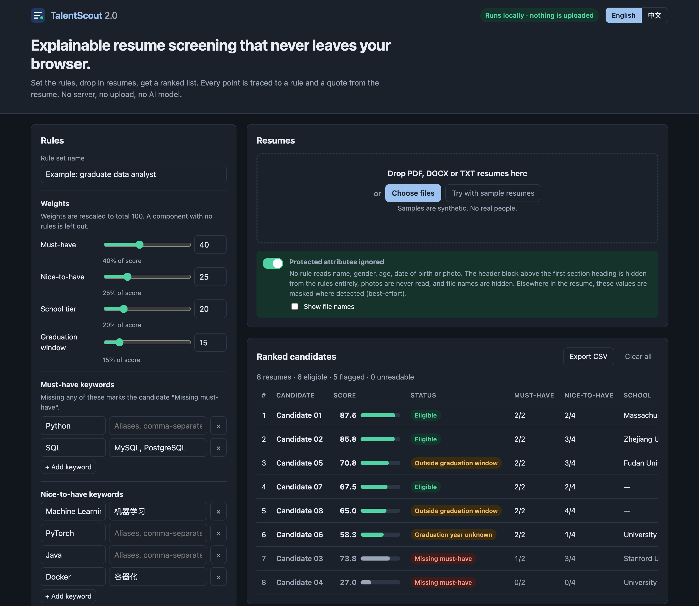

# TalentScout 2.0

**可解释的简历筛选工具，数据不出浏览器。**
[English](README.md)（英文版为完整文档，本页为摘要）

设定规则，拖入简历，得到排序结果。每一分都能追溯到具体规则、原因和简历原文。
没有服务器，不上传文件，不使用 AI 模型，分数是可以手工核对的加法。



> **说明：** 这是一个作品集项目，定位是辅助人工评审。它只在虚构数据上做过评估，
> 没有在真实求职者身上测试过。用于任何重要场景之前，请先阅读“已知局限”。

## 使用方法

需要 [Node.js](https://nodejs.org) 22 或更高版本：

```bash
npm start
```

然后打开 <http://localhost:8080>，点击“用示例简历试一试”，或拖入 [`samples/`](samples/) 中的文件。

直接双击 `index.html` **无法运行**：浏览器不允许在 `file://` 页面加载 JavaScript 模块，
页面会提示改用 `npm start`。

## 功能

- **规则编辑器**：必备关键词、加分关键词（支持别名）、院校分级、毕业时间范围、可调权重；规则可保存和加载为 JSON 文件。
- **批量上传**：支持 PDF、DOCX、TXT，中英文简历均可，全部在浏览器内解析。
- **排序结果**：先按是否合格、再按得分排序，可导出 CSV。
- **匹配报告**：逐条列出命中的规则、得分、原因和简历中的依据原文。
- **忽略受保护属性**：任何规则都不读取姓名、性别、年龄、出生日期和照片；简历页眉信息区对规则完全不可见。
- **中英文界面**，报告和导出同样支持两种语言。

## 评分方式

总分 0–100，由四部分相加，权重可调并按比例换算为 100。

| 部分 | 规则 | 默认权重 |
|---|---|---|
| 必备关键词 | 按命中比例计分；缺少任意一项即标记“缺少必备项” | 40 |
| 加分关键词 | 按命中比例计分 | 25 |
| 院校分级 | 每个分级对应该项权重的一定比例 | 20 |
| 毕业时间 | 在范围内得满分；范围外该项记 0 分，或标记为不合格（可选） | 15 |

- 不会悄悄丢弃任何人：缺少必备项的候选人排在后面，但仍在列表中并附报告。
- “Java” 不会命中 “JavaScript”，“SQL” 不会命中 “NoSQL”。
- 识别否定表述：“尚未学习 Python”“No experience with Python” 不得分，报告会说明原因。
- 支持多种毕业时间写法：`2021.09 - 2025.06`、`2025届`、`2025年6月毕业`、`Class of 2025` 等；无法识别时标记为“未知”，不做猜测。
- 扫描件等没有文字层的文件标记为“无法读取”，而不是 0 分。

## 隐私

简历内容只存在于当前浏览器标签页的内存中，不保存、不上传。可以自行验证：
打开开发者工具的“网络”面板上传一份简历，所有请求都指向本站；页面的内容安全策略
（`connect-src 'self'`）会让浏览器拦截任何发往其他站点的请求。

## 评估结果（虚构数据）

在 50 份带标注的虚构简历上（[data/synthetic/](data/synthetic/README.md)）：

| 系统 | 精确率 | 召回率 |
|---|---|---|
| TalentScout | 87.0% | 76.9% |
| 普通关键词基线 | 57.6% | 73.1% |

- 仅改变姓名、性别、年龄、出生日期或照片：300 个变体中 **0 个**分数发生变化。
- 身份信息出现在页眉之外（自我评价、项目描述、网址等）时，26 个值中遮蔽了 17 个，这是目前的薄弱环节。

**这些数字不代表在真实简历上的准确率。** 数据集与引擎出自同一作者，样本量小。
详见 [docs/EVALUATION.md](docs/EVALUATION.md) 和 [docs/ABLATION.md](docs/ABLATION.md)（英文）。

## 已知局限

- 只在虚构数据上评估过，不对真实招聘效果作任何声明。
- 基于规则而非语义理解：只写了 “pandas、NumPy” 而没写 “Python” 会被漏掉；“计划学习：SQL” 会被算作命中。
- “二〇二五届”等中文数字年份、“2023.09 - 至今” 等未写明毕业时间的情况会标记为未知。
- 院校匹配依赖你填写的名单；毕业年份与年龄相关，院校分级与背景相关，这两项属于间接因素，工具只能让它们可见、可关闭，无法消除其影响。
- 不支持扫描件（需要 OCR）；多栏排版的 PDF 文字顺序可能不准确；仅在 Chromium 浏览器中测试过。
- 没有做过偏差审计：项目未使用任何真实人口统计数据。

## 法律与合规

[docs/COMPLIANCE.md](docs/COMPLIANCE.md)（英文）梳理了欧盟《人工智能法》与 GDPR、美国联邦法律与纽约市
第 144 号地方法、中国《个人信息保护法》《就业促进法》《妇女权益保障法》等与自动化招聘工具相关的规定，
附一手来源链接，并标明了未能核实的内容。**该文档不构成法律意见。**

## 许可证

[MIT](LICENSE)。仓库中的示例和测试数据全部为虚构，不包含任何真实个人信息。
